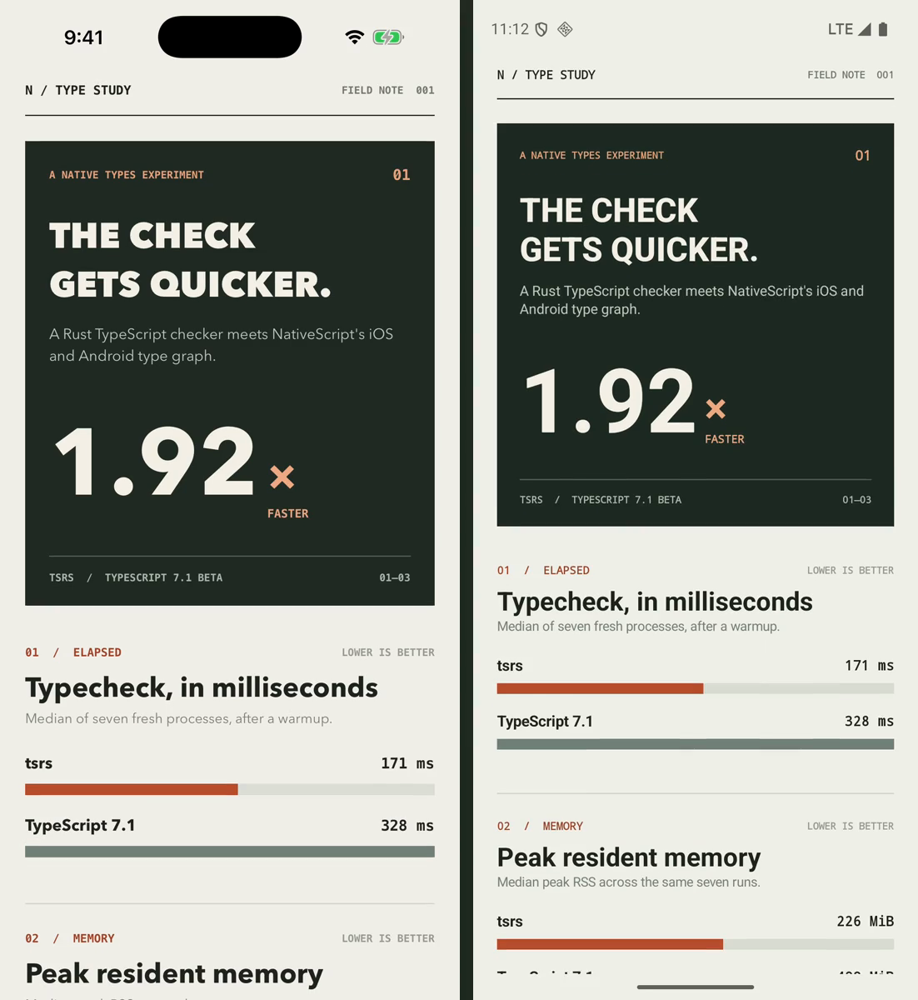

# NativeScript × tsrs

An iOS and Android NativeScript-Vue app that records a local typecheck comparison and displays the results as a small field note. The experiment was prompted by [Cloudflare's introduction to `tsrs`](https://blog.cloudflare.com/typescript-rust-port/).

<a href="docs/ios-android-side-by-side.mp4"></a>

[Watch the iOS and Android simulators side by side](docs/ios-android-side-by-side.mp4)

## Run it

```sh
npm ci
npm run bench
ns run ios       # or ns run android
```

`npm run bench` writes a fresh, device-local snapshot to [`app/benchmark-results.json`](app/benchmark-results.json). Rebuild or live sync the app to see it. The app displays the last recorded snapshot; the benchmark runs on the development machine, not on the phone.

For individual checks, use `npm run check:tsrs` and `npm run check:tsgo`. `npm run typecheck` runs `vue-tsc` for the Vue single-file components. The Vite app continues to use TypeScript 6 because current `vue-tsc` cannot load TypeScript 7's internal package path. The benchmark installs TypeScript 7.1 separately as `typescript-benchmark`.

## What is measured

Both native compiler binaries typecheck `tsconfig.bench.json` with `--noEmit --checkers 4`. The runner makes one warmup invocation per compiler, then alternates their order over seven fresh-process runs. It records wall time and peak resident memory for each invocation, reports medians, and verifies that both resolve the exact same NativeScript platform declaration file list. Every run must exit successfully.

[`types/references.d.ts`](types/references.d.ts) brings in the default NativeScript declarations plus CoreLocation and SceneKit. [`app/native-workload.ts`](app/native-workload.ts) references representative UIKit, SceneKit, CoreLocation, Android SDK, and AndroidX surfaces. The snapshot on this machine includes 47 NativeScript declaration files totaling 16.4 MiB. `skipLibCheck` follows the project's normal config, so the declarations are parsed and resolved but their bodies are not separately checked. NativeScript-Vue templates are not typechecked by either CLI in this comparison; `vue-tsc` handles those separately.

The recorded run used an Apple M3 Max, four checker threads, `tsrs` 0.18.0 targeting a TypeScript 7.1 development commit, and official TypeScript 7.1 beta. These releases include slightly different standard library files. Results on this small app should be treated as a local startup-and-types workload, not as a universal speedup claim. The approach follows [the `tsrs` CLI guidance](https://github.com/oxc-project/tsrs/blob/main/docs/USAGE.md) and its [equal-thread benchmark methodology](https://github.com/oxc-project/tsrs/blob/main/bench/README.md).
